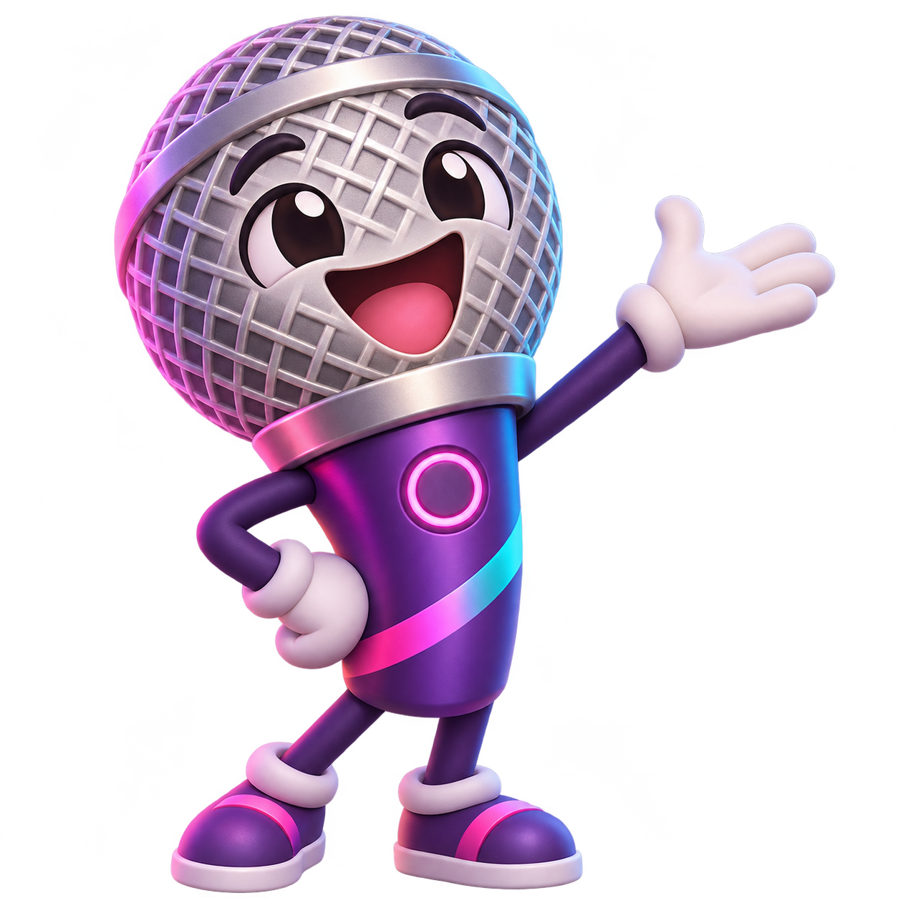

# Mascote — conceito inicial

Microfone antropomórfico em pose de boas-vindas, com expressão alegre, acabamento 3D e cores de festa. Conceito proposto para o karaokê em grupo; nome e identidade final ainda não definidos.

- Arquivo: `mascote-microfone-v1.png`.
- Fundo transparente, preservando o alpha original.
- Usos sugeridos: boas-vindas no lobby, ajuda na entrada e celebração de resultados.
- Manter proporção, não recortar mãos/pés e preservar espaço em torno do personagem.
- No palco, usar fora da área do vídeo e sem cobrir o QR permanente da sala.
- Esta versão é uma ilustração estática; animações e expressões adicionais não fazem parte deste arquivo.

Gerado com a ferramenta integrada de imagens. O [prompt completo](PROMPT.md) está registrado para referência e evolução visual. A versão inicial permanece preservada para revisão.

## Expressões de resultado

`mascote-reacoes-v1.png` é uma nova folha 2×2 gerada com a ferramenta integrada `image_gen`, a partir da imagem original, com fundo transparente. A original não foi substituída. Quadrantes: confuso (superior esquerdo), incentivo (superior direito), dançando (inferior esquerdo), comemoração (inferior direito). A cópia servida pela aplicação está em `apps/web/public/mascot-reactions.png`.

O [prompt das expressões](PROMPT-REACOES.md) registra a edição completa. A aplicação seleciona os quadrantes por CSS, preservando o personagem inteiro. Animações de balanço/entrada são feitas em CSS; a imagem não é um vídeo ou modelo com animação esquelética.

### Correção de transparência

A versão usada atualmente é `mascote-reacoes-v2.png`, servida como `apps/web/public/mascot-reactions-v2.png`. Foi editada com a ferramenta integrada de imagens para remover o halo difuso/sombra externa que revelava o corte quadrado de cada quadrante e deixar margem transparente entre as poses. A URL versionada evita reutilizar a imagem antiga do cache. As versões anteriores permanecem como histórico. [Prompt da correção](PROMPT-TRANSPARENCIA.md).

## Padronização atual (v3)

A aplicação usa nove imagens individuais em apps/web/public/mascot/v3, com cinco dedos em cada mão. As folhas antigas permanecem apenas como histórico. Veja docs/23-mascote-e-copyright.md para poses, prompts e decisões.
