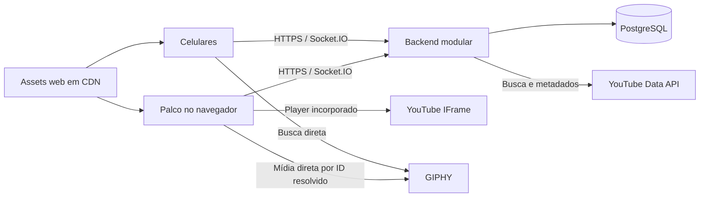

# 04 — Arquitetura e tecnologia

> Atualização de implementação (08/11/2026): este documento preserva a especificação inicial. Os padrões foram adotados por autorização do pedido; decisões concretas e desvios estão em [11 — Decisões implementadas](11-decisoes-implementacao.md), e o aceite por etapa em [12 — Validação](12-validacao.md).

## Escolha recomendada

Usar um **monólito modular no backend**, uma aplicação web responsiva e PostgreSQL. O produto precisa principalmente de estado compartilhado confiável, e não de muitos serviços independentes.

| Camada | Proposta | Justificativa de projeto |
| --- | --- | --- |
| Interface | React + TypeScript + Vite | Uma SPA atende celulares e palco; renderização de servidor não é necessária para o núcleo autenticado |
| Navegação e dados | React Router + TanStack Query | Rotas explícitas e controle de requisições/cache HTTP; estado da sala reconciliado por versão |
| UI | Tailwind CSS + primitivas acessíveis Radix | Tokens e componentes reutilizáveis com liberdade visual |
| Backend | Node.js LTS + NestJS | Módulos claros para salas, fila, votação, reprodução e integrações |
| Tempo real | Socket.IO | Canal bidirecional com ACK; protocolo de aplicação deve tratar perdas e duplicação |
| Persistência | PostgreSQL + Drizzle ORM | Transações e restrições; possibilidade de SQL explícito para concorrência |
| Validação | Zod e contratos TypeScript compartilhados | Formatos validados em fronteiras; regras críticas continuam no domínio do servidor |
| Testes | Vitest, testes de integração com PostgreSQL real, Playwright | Regras determinísticas, concorrência e jornadas entre navegadores |
| Empacotamento | pnpm workspaces + Docker | Repositório único e ambiente reproduzível |
| Diagnóstico | Logs estruturados, métricas e captura de erros | Encontrar divergências, falhas de integração e problemas de conexão |

São escolhas propostas para este produto, não uma comparação exaustiva ou uma prova de superioridade. Fixar versões estáveis e compatíveis no início da implementação, registrar Node/package manager e commitar lockfile. Não usar `latest` em produção.

O Vite fornece desenvolvimento e build para assets estáticos; o NestJS dispõe de adapters de WebSocket, incluindo integração com Socket.IO. Essas capacidades sustentam a separação proposta. Fontes: [Vite](https://vite.dev/guide/) e [NestJS adapters](https://docs.nestjs.com/websockets/adapter).

### Alternativas consideradas

| Alternativa | Quando faria sentido | Decisão nesta proposta |
| --- | --- | --- |
| Next.js | Produto com páginas públicas indexáveis, conteúdo editorial e renderização de servidor | Reavaliar se esses requisitos aparecerem; não é necessário para a sala |
| React + Fastify diretamente | Equipe que prefere backend menor e já domina disciplina de módulos | Viável; NestJS escolhido pela organização explícita |
| Supabase/Firebase como centro da lógica | Protótipo com prioridade absoluta em infraestrutura gerenciada | Evitar espalhar regras da fila e votação entre clientes e políticas de dados |
| Microserviços | Equipes e cargas independentes com necessidade comprovada | Adiar até haver evidência |

## Fluxo de componentes



O backend não retransmite áudio, vídeo ou arquivos de GIF. O protocolo de reações transmite identificadores e contexto da sala, não arquivos.

## Organização proposta do repositório futuro

```text
apps/
  web/                  # celular e palco
  api/                  # HTTP, socket, workers de manutenção
packages/
  contracts/            # schemas de transporte e códigos de erro
  domain/               # fila, votação, bônus e transições puras
  ui/                   # componentes e tokens
docs/                   # documentação atual
infra/                  # containers e configuração de implantação
```

Módulos do backend: `Sessions`, `Rooms`, `Participants`, `Queue`, `Performances`, `Voting`, `Reactions`, `Playback`, `YouTube` e `Maintenance`.

Não importar frameworks de UI, persistência ou Socket.IO no domínio. Adaptadores traduzem comandos em operações de domínio. A API nunca aceita contadores, prioridade ou média calculados pelo cliente.

## Fonte de verdade e concorrência

PostgreSQL é a fonte de verdade para sala, fila, apresentações e votos. Presença e reações são efêmeras; não dependem de gravação de cada pacote.

Para cada comando que modifica a sala:

1. Autenticar sessão e verificar autorização atual.
2. Iniciar transação e bloquear a linha da sala com `SELECT ... FOR UPDATE`.
3. Verificar `commandId`, versão esperada quando aplicável, prazo e estado.
4. Aplicar mudanças, gravar evento na outbox e incrementar `roomVersion`.
5. Commit; responder ACK e publicar o novo estado.

Esse bloqueio serializa decisões concorrentes da mesma sala. Bloquear sempre sala antes de apresentação e votos para reduzir deadlocks. Não chamar APIs externas enquanto mantiver o bloqueio. Para adicionar vídeo: validar fora da transação, depois revalidar estado e limites dentro dela.

O PostgreSQL oferece bloqueios de linha para impedir mudanças concorrentes incompatíveis; a disciplina acima é uma escolha da aplicação. [Referência de locking](https://www.postgresql.org/docs/current/explicit-locking.html).

Usar outbox transacional evita perder uma alteração confirmada quando a publicação falhar. O consumidor pode publicar duas vezes; clientes descartam duplicatas por `eventId`/versão. O retorno HTTP ou ACK pode chegar depois do evento: a versão impede regressão.

## Reconexão e tempo real

Socket.IO não garante por padrão que cada mensagem seja entregue; recuperação de conexão também pode falhar. A aplicação precisa de idempotência e reconciliação próprias. Fontes: [entrega](https://socket.io/docs/v4/delivery-guarantees/) e [recuperação](https://socket.io/docs/v4/connection-state-recovery).

Na conexão/reconexão, autenticar e obter snapshot com `roomVersion`, `serverTime`, estado, fila, apresentação e dados de votação permitidos para o papel. O servidor associa o socket à sala durante o handshake de sincronização; o cliente guarda eventos recebidos enquanto o snapshot chega e só aplica os posteriores à sua versão.

Para o MVP, eventos duráveis podem levar a projeção atualizada completa da sala, pequena no limite proposto. Receber versão maior permite substituir a projeção; receber menor ou igual não reverte nada. Uma lacuna em eventos incrementais futuros exige novo snapshot. O estado privado de voto/oferta é transmitido apenas ao destinatário.

Não colocar votos em buffer offline para envio tardio. Comandos de adicionar música podem ser reenviados com o mesmo `commandId`, sujeitos ao estado atual. Emojis/GIFs expirados são descartados sem replay.

## Cronômetros e recuperação de processo

Persistir deadline da votação e estado de finalização. Um worker consulta votações vencidas a cada 100 ms, obtém lock da sala e finaliza de forma idempotente. Um timer em memória pode acelerar, mas não ser a única garantia. Na inicialização, reconciliar deadlines vencidos antes de aceitar avanço de apresentações.

“Até 10 segundos” significa que o servidor nunca aceita voto após o deadline. A publicação do resultado tem latência de processamento/rede: a meta inicial é até 500 ms depois do prazo em operação normal. Após indisponibilidade, não reabrir a janela para compensar o tempo perdido.

## Implantação inicial

Assets web estáticos por CDN; API Node em serviço/container com suporte a conexões persistentes; PostgreSQL gerenciado com backups. Usar um único domínio com `/api` e `/socket.io` encaminhados à API facilita cookies e evita CORS desnecessário.

Começar com uma instância da API e um worker lógico de manutenção no mesmo deploy. Não hospedar o gateway em funções curtas sem suporte documentado a conexões persistentes. Separar ambientes local, homologação e produção, incluindo bancos e credenciais.

Escalar horizontalmente somente depois de medir. Nessa fase, adicionar coordenação distribuída de presença/rate limits, adapter de broadcast, eleição do palco e consumidores de outbox concorrentes. Avaliar Redis Streams se for desejada recuperação do Socket.IO com múltiplas instâncias; não assumir compatibilidade de qualquer adapter.

O custo operacional deve ser estimado após a prova técnica: computação da API, banco/backups, tráfego de eventos, monitoramento, domínio e condições de produção dos provedores. Sem orçamento ou volume real, não fixar um valor mensal fictício.
