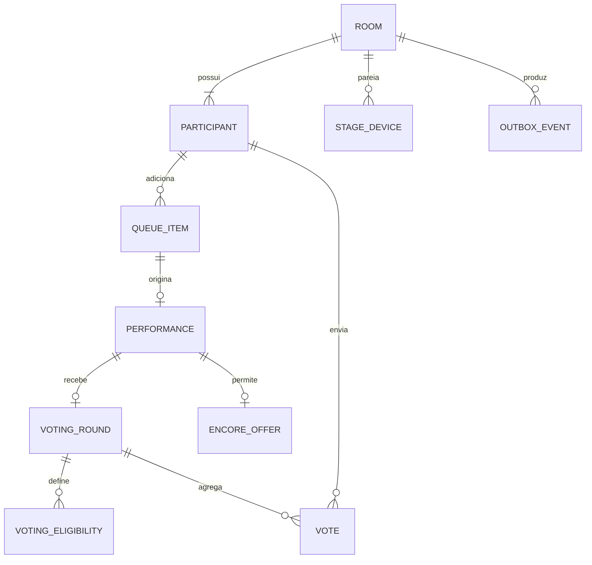

# 05 — Modelo de dados e contratos

> Atualização de implementação (08/11/2026): este documento preserva a especificação inicial. Os padrões foram adotados por autorização do pedido; decisões concretas e desvios estão em [11 — Decisões implementadas](11-decisoes-implementacao.md), e o aceite por etapa em [12 — Validação](12-validacao.md).

Este documento especifica o desenho lógico inicial. Não é uma migração executada nem um contrato OpenAPI/AsyncAPI já validado por ferramentas. A implementação deverá gerar esses artefatos a partir dos schemas versionados.

## Convenções

IDs internos opacos; datas em UTC com timezone; exibição em pt-BR. Valores de voto e soma são inteiros. Média é derivada de soma/quantidade; não usar ponto flutuante para decidir nota perfeita. Sequências da fila são crescentes e atribuídas pelo servidor sob lock da sala.

Toda entidade de participante, música ou apresentação pertence a uma sala. Usar chaves estrangeiras compostas ou validação equivalente reforçada no banco para impedir referências entre salas.

## Entidades

| Entidade | Campos principais | Restrições e finalidade |
| --- | --- | --- |
| Room | id, code, name, hostParticipantId, state, recoveryFromState, version, nextQueueSequence, settings, createdAt, closedAt, expiresAt | Código ativo único; host obrigatório; configuração validada |
| Participant | id, roomId, displayName, avatar, status, turnsConsumed, joinedAt, lastSeenAt | Contador ≥ 0; ACTIVE/LEFT/REMOVED; identidade independente do socket |
| Session | id, tokenHash, participantId ou stageDeviceId, expiresAt, revokedAt | Token secreto armazenado somente como hash; escopo explícito |
| StageDevice | id, roomId, playbackEpoch, pairedAt, lastSeenAt, revokedAt | No máximo um palco ativo por sala |
| PairingRequest | id, roomId, codeHash, expiresAt, approvedBy, consumedAt | Expiração curta; consumo único; aprovação pelo anfitrião |
| QueueItem | id, roomId, participantId, youtubeVideoId, enqueueSequence, status, createdAt, failureReason, retryOfId | WAITING/RESERVED/PLAYING/COMPLETED/SKIPPED/FAILED/CANCELLED; elegibilidade depende também de presença |
| VideoMetadata | videoId, title, channelTitle, thumbnailUrl, durationSeconds, embeddable, regionData, fetchedAt, refreshBy | Dados externos com ciclo de atualização; não confundir título com autoria musical |
| Performance | id, roomId, queueItemId, singerId, status, startedAt, endedAt, playbackEpoch, turnApplied, turnReverted, isEncore | Uma tentativa ativa por sala; item associado de forma consistente |
| VotingRound | id, roomId, performanceId, state, openedAt, deadlineAt, closedAt, closeReason, sum, count | Uma votação por apresentação; prazo imutável |
| VotingEligibility | roundId, participantId, valid, invalidationReason | Elegibilidade congelada e alteração administrativa auditável |
| Vote | id, roundId, participantId, score, acceptedAt, invalidatedAt | UNIQUE(roundId, participantId); CHECK score entre 0 e 10 |
| EncoreOffer | id, roomId, performanceId, participantId, targetQueueItemId, state, createdAt, decidedAt | OFFERED/ACCEPTED/DECLINED/EXPIRED/CANCELLED/CONSUMED; uma oferta por apresentação |
| CommandReceipt | sessionId, commandId, kind, payloadHash, response, createdAt | Mesmo ID + payload devolve resultado anterior; payload diferente gera conflito |
| OutboxEvent | id, roomId, roomVersion, type, payload, createdAt, publishedAt | Estado e evento gravados juntos; publicação repetível |
| AuditEntry | id, roomId, actorId, action, targetId, reason, createdAt | Transferências, remoções e correções; não guardar segredos |

Estado de reação não tem tabela permanente na primeira versão. Guardar apenas dados transitórios necessários ao envio. Se presença usar memória no deploy inicial, reinício marca participantes como desconectados até novo heartbeat, sem apagar identidade.

## Relações



## Invariantes e índices

- Índice único parcial impede duas apresentações ativas na mesma sala.
- Índice único em `(roomId, enqueueSequence)`; sequência atribuída atomicamente.
- Item reservado/tocando não pode pertencer a outra apresentação ativa.
- `turnApplied` e `turnReverted` impedem consumo/devolução duplicados.
- `hostParticipantId` aponta para participante da própria sala; criar ambos com FK diferível ou fluxo transacional equivalente.
- A votação não aceita cantor, pessoa não elegível, nota fracionária ou prazo vencido.
- `sum` e `count` finais são calculados a partir dos votos válidos na mesma transação de fechamento.
- Consultas principais: itens por sala/status/sequence; participantes por sala; rodadas abertas por deadline; outbox não publicada; sessões por hash/expiração.
- Nenhum endpoint permite trocar `singerId` para outra pessoa ao adicionar música no MVP.

## API HTTP proposta

Prefixo `/api/v1`. Autenticação por sessão em cookie seguro HttpOnly. Requisições mutáveis usam `commandId` no corpo e proteção CSRF. A sessão determina o ator; nunca confiar em `participantId` enviado como identidade.

| Método e rota | Entrada/resposta essencial | Acesso |
| --- | --- | --- |
| POST `/rooms` | apelido/avatar/nome → sala e sessão anfitriã | Público protegido |
| GET `/invites/:code` | nome, disponibilidade e regras resumidas | Público limitado |
| POST `/rooms/join` | código/apelido/avatar → participante e sessão | Convite válido |
| GET `/rooms/:id/snapshot` | projeção autorizada e versão | Membro ou palco |
| GET `/rooms/:id/music/search?q=&cursor=` | resultados, duração quando disponível, próximo cursor | Membro ativo |
| POST `/rooms/:id/queue` | videoId → item e nova versão | Participante ativo |
| DELETE `/rooms/:id/queue/:itemId` | cancelar item pendente | Dono ou anfitrião |
| POST `/rooms/:id/performances/prepare` | selecionar próximo → apresentação preparada | Anfitrião |
| POST `/rooms/:id/playback/commands` | START/PAUSE/RESUME/SKIP/TECHNICAL_CANCEL → comando ao palco | Anfitrião |
| POST `/rooms/:id/voting/:roundId/votes` | score → voto aceito | Elegível |
| POST `/rooms/:id/encore/:offerId/decision` | ACCEPT/DECLINE → estado | Dono da oferta |
| POST `/rooms/:id/host-transfer` | targetParticipantId → versão | Anfitrião |
| POST `/rooms/:id/participants/:id/remove` | motivo → versão | Anfitrião |
| POST `/rooms/:id/leave` | saída explícita | Participante; host deve transferir/encerrar |
| PATCH `/rooms/:id/settings` | entrada/reação aberta ou fechada | Anfitrião |
| POST `/rooms/:id/pairing-requests` | criar solicitação com código temporário | Anfitrião |
| POST `/pairing-requests/:id/approve` | aprovar dispositivo identificado | Anfitrião da sala |
| POST `/pairing-requests/redeem` | código/solicitação aprovada → sessão de palco | Dispositivo autorizado |
| POST `/rooms/:id/close` | encerramento → resumo | Anfitrião |
| GET `/rooms/:id/summary` | histórico e médias | Membro |

Comandos de domínio reutilizam handlers independentemente do transporte. No MVP, HTTP atende mutações duráveis; sockets publicam projeções, ACKs de reprodução e reações. Não implementar duas regras diferentes para a mesma ação.

### Exemplo de voto

```json
{
  "commandId": "uuid-gerado-no-cliente",
  "score": 9
}
```

Resposta de sucesso inclui `roundId`, `acceptedScore`, `acceptedAt`, `roomVersion` e `serverTime`. Reenvio com mesmo ID e corpo devolve a resposta original; um segundo voto com outro ID gera `ALREADY_VOTED`.

### Erros uniformes

```json
{
  "error": {
    "code": "VOTING_CLOSED",
    "message": "A votação já terminou.",
    "retryable": false,
    "requestId": "identificador-tecnico"
  },
  "serverTime": "2026-11-08T22:00:10.000Z"
}
```

Classes HTTP: 400 para formato inválido; 401 sem sessão; 403 sem permissão; 404 para recurso inexistente/inacessível; 409 para estado ou versão conflitante; 410 para convite expirado; 422 para regra violada; 429 para limite; 502/503 para provedor indisponível. Códigos de domínio incluem `ROOM_FULL`, `QUEUE_LIMIT`, `VIDEO_UNAVAILABLE`, `SELF_VOTE`, `ALREADY_VOTED`, `STALE_PLAYBACK_EPOCH`, `PROVIDER_QUOTA_EXCEEDED` e `VERSION_CONFLICT`.

## Eventos em tempo real

Envelope durável: `{ eventId, type, roomId, roomVersion, occurredAt, payload }`. Para evento privado, incluir destinatário no roteamento do servidor, não como filtro confiado ao cliente. Eventos efêmeros têm ID e expiração, mas não incrementam versão durável.

| Evento | Direção | Conteúdo e garantia |
| --- | --- | --- |
| `session.sync` | Cliente → servidor | Versão conhecida; autenticar, associar socket e devolver snapshot |
| `room.state` | Servidor → sala | Projeção pública atualizada, sem votos individuais |
| `participant.private-state` | Servidor → participante | Meu voto e minhas ofertas; não broadcast geral |
| `playback.command` | Servidor → palco | CommandId, performanceId, epoch e ação; palco confirma execução |
| `playback.report` | Palco → servidor | Estado observado, sequência local, epoch, performanceId e commandId relacionado |
| `presence.heartbeat` | Clientes → servidor | Renovar presença; participante a cada 10 s, palco a cada 5 s |
| `reaction.send` | Participante → servidor | PerformanceId, tipo EMOJI/GIF, emoji permitido ou provider+gifId |
| `reaction.display` | Servidor → sala | Autor público, reação, createdAt e expiresAt; sem replay |
| `session.revoked` | Servidor → sessão | Expulsão, transferência de credencial ou encerramento |

O servidor valida pertinência à sala em **cada comando**, inclusive depois de uma mudança de anfitrião. `playback.report` usa sequência por epoch para ignorar relatos antigos/duplicados. Exibição de resultado e fila deriva de `room.state`, evitando múltiplos eventos concorrentes contraditórios.

### Reações GIF

O payload inclui apenas provedor e ID. O cliente receptor resolve o ID diretamente no provedor, sem receber URL arbitrária do usuário. Se resolução, rating ou reprodução falhar, omitir a reação e manter a sessão funcionando. No piloto, medir o impacto de uma consulta por GIF em cada dispositivo; considerar exibição de GIF apenas no palco se a cota não comportar a distribuição. A decisão deve anteceder o lançamento.

## Retenção proposta

Sessão encerrada mantém resumo por 24 horas; depois, remover apelidos, sessões, fila e votos associados. Convites e pareamentos expiram antes. Receipts podem durar enquanto a sala for consultável; outbox publicada pode ser removida após 24 horas. Logs operacionais sem conteúdo pessoal: 14 dias. Essas durações são escolhas iniciais a revisar conforme finalidade e operação.

Metadados externos seguem também os limites descritos no documento 06. Backups têm retenção e eliminação próprias; não prometer exclusão física imediata de cópias imutáveis. Não registrar payload bruto de votos, tokens, apelidos ou termos de busca em logs.
